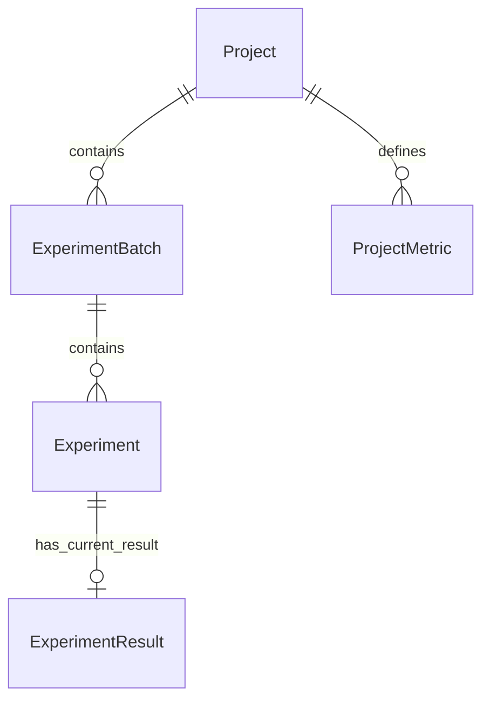

# 项目级共享指标设计与使用

2026-10-12 讨论并由用户授权实现，2026-10-13 完成独立功能增量与验证。本文替换原讨论稿，记录实际实现；阶段 6B 的窗口拖动、本人讲解和视频交付仍待人工完成。

## 项目与指标

Project 组织同一评测任务、可比测试条件和统一评价口径下的实验。一个项目可以只研究同一模型的参数或版本，也可以组织同类模型的对照；系统保留每条 Experiment 的 model_name，没有额外强制模型类型字段。

项目下所有 Batch / Experiment 共享指标定义，分别记录自己的数值。原四个核心实体关系保持 Project → Batch → Experiment → 0..1 ExperimentResult；新增 ProjectMetric 为项目级定义，结果中 custom_metrics 保存自定义数值。



## 页面使用

1. 项目管理中点击项目行的“查看批次”，下方出现该项目的“共享评价指标”。
2. 点击“新增指标”，填写指标键、显示名称、单位、方向和可选上下限。
3. 在该项目任意批次的实验中打开“录入结果”或“编辑结果”，表单自动出现项目指标，并显示键名、方向和范围。
4. 粘贴平铺 JSON 后自动填入，可手动修正，最后点击“保存结果”。例如先定义 latency_ms 和 task_score，再粘贴：

```json
{
  "accuracy": 0.86,
  "latency_ms": 23.5,
  "task_score": 85
}
```

未提供或为 null 的项会清空对应输入。编辑时如需保留其他项，请一并提供，或填入后补齐再保存；PUT 仍为完整更新。JSON 只改变表单，保存使用最终修正值；非法 JSON 不覆盖原输入，并阻止保存，直至修正或清空 JSON。

5. 比较页面根据每项方向标记最佳和并列最佳，自定义指标显示项目归属及单位，并分别画独立数值轴图；重新比较读取最新结果。仅有自定义数值时不占用空间显示空的系统图表，自定义列优先展示。

## 定义和校验

| 属性 | 实际规则 |
| --- | --- |
| key | trim + lowercase；以字母开头，仅含小写字母、数字、下划线，1～64 字符；同项目唯一，不与系统字段或保留键冲突 |
| name | 必填，trim 后非空，可使用中文 |
| unit | 可选文本，trim 后保存；不自动转换单位 |
| direction | max（越大越好）或 min（越小越好） |
| lower_bound / upper_bound | 各自可选，有限数值，包含边界；两项都有时下限不得大于上限 |

系统五项默认指标不允许通过此页面修改或删除：accuracy / precision / recall / f1 范围 [0,1]，loss >=0。新自定义指标遵循自己的范围；没有下限时可以记录负数。单位、数值和范围不会由名称推断。

结果允许只填写自定义指标，也可以混合系统指标；所有项至少一个有效有限数值。0 合法，bool、字符串数字、NaN、±Infinity 拒绝。自定义键必须已经属于实验所在项目，不能借用其他项目的定义；空值在存储中省略，在详情和比较中保持缺失语义，不补 0。

已有非空数值引用的定义仅允许改显示名称，不允许改键名、单位、方向、范围或删除，避免旧结果被重新解释。未引用的定义可修改或删除；前端编辑时键名锁定，如需换键，可删除未使用定义后重新添加。数据库触发器也保护已引用定义和数值类型、归属、范围。

原五项继续支持跨项目比较。自定义指标按所属项目分别比较：即使不同项目使用相同键名、单位或方向，也不自动合并。跨项目选择时分别显示各项目的列和图；其他项目实验在该列为 null / `-`。最佳只使用所属项目已选实验的非空值，允许并列，全空无最佳；不强制所有实验都已录入结果。

## 数据与 API

- 新增 project_metrics 表，包含 project_id 外键、项目内键唯一约束、方向和上下限约束。空项目删除时定义随项目级联删除。
- experiment_results 新增 custom_metrics JSON 对象列，仍只有一份当前结果，原五项列、范围约束、UNIQUE 和实验删除 CASCADE 保留。空结果检查支持有效自定义数值。
- SQLite INSERT / UPDATE 触发器验证自定义值为有限数值、键归属及范围；定义 UPDATE / DELETE 触发器阻止修改或删除已使用口径。
- `GET /projects/{project_id}/metrics`：返回五项系统定义和本项目自定义定义。
- `POST /projects/{project_id}/metrics`：新增定义；`PUT / DELETE /projects/{project_id}/metrics/{metric_id}`：完整修改 / 受控删除。无父资源或指标返回 404，校验失败 422，重复或使用中冲突 409，中文业务说明可见。
- Result API 保留原路径；HTTP 请求的自定义值位于 custom_metrics 对象，例如 `{"custom_metrics":{"latency_ms":23.5}}`。这与表单中方便粘贴的平铺 JSON 区分。
- 原 Result / Compare 响应没有自定义数据时保持原字段结构；有数据时 Result 增加 custom_metrics。
- Compare 有定义时额外返回 custom_metrics 列表，每项含 definition、project_name、按实验 ID 的 values 和 best。保留原 experiments / best_by_metric，单条带关联加载的 SELECT、只读、无 commit、无历史或缓存；多指标关联不会重复实验。

## SQLite 升级和备份

启动检测到旧结果表时，在 backend/data 生成 `aiexphub.pre-project-metrics-<UTC 时间>.db` 备份，再用显式事务升级结果表。旧 id、experiment_id、五项指标和 updated_at 原样复制，自定义数值初始化为 `{}`；外键检查成功才提交，失败回滚并保留备份。取得写锁后会再次检查结构，避免另一启动者已升级时覆盖其自定义数据。已升级库重复启动不重新复制结果。

随后 create_all 创建缺失的指标定义表，并安装约束触发器。这是针对当前旧结构的指定升级，不是任意版本的通用迁移系统。备份和数据库都由 .gitignore 排除；生产库升级前应先停止旧服务。恢复时需先停止服务，保留当前库，再使用备份和兼容代码恢复，不能直接删除用户数据库。

本工作区 2026-10-12 实际升级，备份为 `backend/data/aiexphub.pre-project-metrics-20261012T125035804776Z.db`。原有数据逐项摘要核对未变，最终四表计数为 2 / 2 / 3 / 2；没有替用户清空原演示数据或其录入的 EXP-003。临时指标随临时项目清理，project_metrics 最终为 0，外键检查无错误。

## 真实验证

- 自动测试：原 102 个用例保留，Swagger 接口数量断言同步新增路径；新增 34 个共享指标用例及 3 个迁移用例，共 139 passed、0 failed、0 errors、1 warning，最终 2026-10-13 耗时 16.60s。
- 覆盖定义归属、键唯一与规范化、保留键、上下限、严格类型、非有限值、失败后原值保持、纯自定义结果、0 / null、完整更新、引用保护、数据库触发器、并列、最新值、项目隔离、单 SELECT 无 commit、旧库保留、幂等、失败回滚和启动竞争检查。
- 前端 TypeScript / Vite build 通过，2266 modules，Vite 输出 837ms；JS 1,623.26 kB / gzip 530.36 kB，保留 >500 kB 警告。保留 TestClient 的第三方弃用警告，未安装或升级依赖。
- 真实页面：创建耗时 min（ms，0～100）和评分 max（分，0～100）；两个不同批次都继承；101 越界拒绝；平铺 JSON 自动填入，手动修正 70→71 后保存；纯自定义结果有效。
- 首次比较实验 B 的 8ms / 85 分最佳；另一标签把 A 改为 5ms / 95 分后，原选择重新比较，表格、摘要和图同步切到 A；每图单个 canvas。
- 已引用指标改上限 100→200 显示拒绝，显示名称“推理耗时”→“平均推理耗时”保存成功；切到其他项目只显示该项目定义；最后回归比较使用新名称。
- 本轮应用 Console warn / error 日志为空，截图在仓库外；临时数据通过正常 API 按 Experiment → Batch → Project 清理，结果和定义正常级联。未把自动截图或容器检查冒充人工窗口拖动。

本次共享指标增量没有新增模型训练、自动计算指标、用户系统或比较历史。其后经用户授权同日增加 [JSON 文件录入、项目模板与批量导入](json-file-import.md)，最新测试状态见该文档。课程视频、本人讲解、5A AA 和 6B 最终提交状态独立保留待办。
